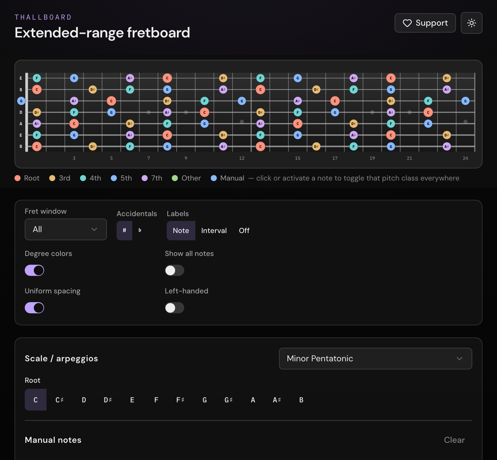

# Thallboard

A fretboard visualizer for **extended-range guitars** — 7-, 8-, and 9-string instruments, drop tunings, and deep detunes that most online tools ignore.

**Live deployment:** [thallboard.com](https://thallboard.com)



Map scales and individual notes onto the neck with player-perspective layout (low string at the bottom, string 1 = high). Built to stay on your machine; presets and session state live in `localStorage`.

## Why

Typical fretboard sites stop at 6 strings and a handful of stock tunings. Thallboard treats low tunings as first-class: global detune from −12 to +12 semitones, per-string open notes, and built-in Std / Drop presets for common ERG setups (including detuned 7- and 8-string variants).

## Features

- **SVG fretboard** — 6–9 strings, 12–24 frets, fret windows (all / 0–12 / 7–19 / top), left-handed flip
- **Tuning** — rich Std/Drop presets (including detuned 6–9 string variants), per-string ±1, drop-lowest, global detune
- **Scales & arpeggios** — diatonic, modes, pentatonic/blues, exotic scales, plus power/sus/triad/7th/extension chord tones
- **Degree colors** — optional root / 3rd / 4th / 5th / 7th / other coloring with scale-aware interval labels
- **Manual highlights** — toggle pitch classes from the picker or by clicking the board
- **Display** — sharps/flats, note or interval labels, show-all vs scale-only, uniform or logarithmic spacing
- **Theme** — dark (default) and light, persisted locally
- **User presets** — save/load/delete named tunings in the browser

## Support

Thallboard is free and local-only. If it helps your practice, you can [sponsor the project on GitHub](https://github.com/sponsors/svencowart).

## Develop

Requires [Bun](https://bun.sh) **1.3.12** (pinned via `packageManager` in `package.json`).

```bash
bun install
bun dev
```

Open the URL Vite prints (usually `http://localhost:5173`).

Lint and format with [Biome](https://biomejs.dev):

```bash
bun run check   # lint + format + organize imports (writes fixes)
bun run ci      # same checks, read-only (matches CI)
bun test        # unit tests
```

CI runs `biome ci`, `bun test`, and `bun run build` on pushes and pull requests to `main`.

See [CONTRIBUTING.md](CONTRIBUTING.md) if you want to open a PR.

## Build

```bash
bun run build
bun run preview
```

Production deploys to [thallboard.com](https://thallboard.com) via GitHub Pages on pushes to `main`.

## Stack

Bun · Vite · React · TypeScript · Tailwind CSS · shadcn/ui · Biome

No backend, no accounts, no audio — theory and visualization only.

## License

[MIT](LICENSE)
